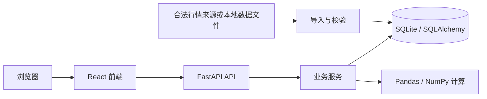

# StockLab 系统架构说明

## 状态与技术选择

本文同时记录长期目标与当前阶段一实现。当前已运行 React 前端、FastAPI 只读演示接口和前后端测试；依赖由 package-lock.json 与 requirements.lock.txt 锁定。SQLite、SQLAlchemy、Pandas、NumPy 属于后续目标，尚未引入。

| 层 | 技术 | 职责 |
| --- | --- | --- |
| 浏览器前端 | React、TypeScript、Vite、Tailwind CSS、ECharts | 学习页面、行情图表、模拟账户和回测结果展示 |
| HTTP API | Python、FastAPI | 输入校验、学习与行情查询、模拟交易及回测接口 |
| 业务与计算 | Python、Pandas、NumPy | 交易规则、指标、策略及回测计算 |
| 数据访问 | SQLAlchemy、SQLite | 持久化与事务管理；本地开发不需要独立数据库服务 |
| 测试 | Pytest；前端类型检查和构建 | 验证业务规则、计算、API 与前端可构建性；后续按需求选择前端测试工具 |

## 请求与数据流



前端不直接访问数据库，也不自行裁定交易是否有效。后端负责交易规则、资金与持仓校验及一致性；前端负责输入提示和展示。开发时分别运行 Vite 和 FastAPI，通过同源 `/api` 与 Vite 开发代理通信；公开部署时再确定 HTTPS 和同源反向代理配置。

## 长期建议目录（按阶段逐步创建）

```text
frontend/                  # 浏览器应用、组件与 API 客户端
backend/
  app/
    api/                   # HTTP 路由和请求/响应模型
    services/              # 学习、行情、交易和回测业务
    models/                # SQLAlchemy 数据模型
    db/                    # 连接与会话管理
    core/                  # 配置等共享基础设施
  tests/                   # Pytest 测试
docs/                      # 项目与运行文档
AGENTS.md                  # 后续开发规范
```

目录按阶段逐步创建，不预建无需求的模块。SQLite 文件、导入数据、日志和本地配置使用明确的可配置路径，后续加入忽略规则；不提交数据库、密钥或大体积行情缓存。

## 模块边界

- 学习：组织章节与内容，规则说明带参考来源及适用日期。
- 行情：隔离数据提供方与应用接口，校验代码、日期、OHLC、成交量、单位及重复记录。技术指标使用有文档的公式和窗口规则。
- 模拟交易：账户、订单、成交、持仓、现金流水各有明确语义。账户初始资金为 100 万元虚拟人民币，金额用精确十进制或整数最小货币单位存储与结算，避免二进制浮点资金误差。订单状态变更和资金持仓更新在同一事务内完成；余额不足、可卖数量不足和重复提交必须显式处理。
- 回测：策略、行情输入、成交模型和绩效计算分离；回测结果不修改模拟账户。首版按有限数据规模执行，耗时任务的后台运行方式待实际需求确定。

## 数据可追溯与时间语义

行情需保存并在界面显示：来源、数据覆盖日期、获取或生成时间、是否模拟、价格单位及复权方式。模拟数据还需说明生成方法；真实历史数据也不能称为实时数据。交易所交易日期按中国市场日期处理；时间戳明确时区，展示默认采用 `Asia/Shanghai`。交易日历不能仅用“周一至周五”代替。

回测保存策略及参数、数据来源与版本或校验标识、日期范围、成交时点、费用、滑点和规则假设，以支持复现。信号仅使用当时已可获得的数据；例如收盘价产生的信号不能默认按同一收盘价无条件成交。

## 测试与运行边界

交易和回测测试采用固定的小型数据集及临时 SQLite，覆盖正常流程和失败条件，不依赖实时外部接口。行情接入另做来源适配验证，不能把网络可达视为数据正确。前端每次相关改动至少执行类型检查和生产构建，并验证涉及的交互。

Windows 本地目标是两个独立进程和本地 SQLite；Node.js、Python 版本及 PowerShell 命令由阶段 1 实测后记录。未来部署再加入认证、用户数据隔离、请求限制、备份及恢复验证，不提前引入无需求的服务。


## 阶段一实际实现

前端 `src/App.tsx` 包含六个路由页面和共享导航；`src/api.ts` 请求 `/api/dashboard`；`src/Chart.tsx` 按需加载 ECharts；`src/styles.css` 结合 Tailwind CSS 实现主题和响应式布局。主题保存到 localStorage，搜索转入行情中心并过滤名称、代码或行业。

后端 `backend/app/main.py` 使用 Pydantic 声明演示响应模型，提供 `/api/health` 与 `/api/dashboard`。固定人工样例没有数据库、认证、行情接入或交易逻辑。首页收益与资产页初始状态分离，不将演示曲线解释为交易账户结果。

开发和本地构建预览都通过 Vite 代理访问后端，FastAPI 无需配置宽泛 CORS。Linux 上已启动并验证响应，Windows 步骤见根目录 README；尚未在 Windows 真机验证。公开部署时仍需配置 SPA 路径回退和 `/api` 反向代理。
